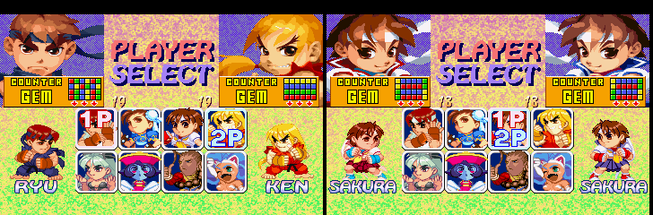

# Super Puzzle Fighter II Turbo X' — PlayStation

A port of the **X' rebalance** to the PlayStation version of Super Puzzle Fighter II Turbo
(NTSC-U, **SLUS-00418**).

X' is David Sirlin's rebalance from Puzzle Fighter HD Remix. It was brought back to
the original arcade game by [KScl/puzzle-fighter-x-prime](https://github.com/KScl/puzzle-fighter-x-prime).
This project reimplements the same logic in the PSX executable. The PSX port is
compiled C rather than 68k assembly, so every change is rewritten from scratch.

## Support
Hey dude! Help me out for a couple of :beers: or a :coffee:!<br/>
[](https://bmc.link/zanac)

## Goals

- New drop patterns for Morrigan, Ryu, Hsien-Ko, Felicia and Sakura
- Garbage: Chun-Li sends 120 %, Devilot 85 %, Akuma 100 % but receives 120 %
- Diamond always sends 80 % ("diamond trick" removed)
- Mei-Ling and Anita count as Hsien-Ko and Donovan (no +25 %); the Versus Difficulty 1-5 handicap stays as in vanilla
- Devilot, Akuma and Dan selectable without codes
- **PSX X' addition — Dan:** new "Gadoken" drop pattern (red spine: columns 1/3/5 red, mixed pairs between) instead of all red; sends 110 % and receives 110 %
- `X'` marker in game
- **Versus stage selector:** RANDOM (default), NORMAL or a fixed stage, chosen by P1 on the select screen
- **Challenges:** when a second player joins an Arcade game, both players choose their character again

## Screenshots

**Title screen.** "X' BALANCE PATCH BY ZANAC" is shown under the copyright.


**Secret characters without codes.** On the bottom row, Down cycles the cell through Devilot → Akuma → Dan → Mei-Ling → Anita and back; Up walks the same ring backwards.
Mei-Ling and Anita get their own name labels, which the original select screen never had.


**New drop patterns.** Counter Gem previews, vanilla (top) vs X' (bottom), generated from the game's own pattern tables.


**In game.** `X'` sits between the win counters, as in the arcade patch.


**Versus stage selector.** P1 picks the stage under the character grid with **R1** (next) and **L1** (previous). From left to right: RANDOM, then AKUMA, and the match that follows on Akuma's stage.


RANDOM changes the stage at every match:


**Challenges in Arcade.** When P2 joins, the defender can change character too. Both cursors start on the last character picked.



## Status

Done:

- **Drop patterns.** New patterns for the five characters, including the Counter Gem previews on the select screen.
- **Damage formula.** It reproduces the arcade X' patch exactly. It was fuzz-tested in an emulator against a Python model of the arcade code.
- **Diamond.** It always applies its penalty, so the diamond trick is gone.
- **Character select.** Pressing Down on the bottom row cycles through Devilot, Akuma, Dan, Mei-Ling and Anita, and the select screen now has name labels for Mei-Ling and Anita.
- **Markers.** `X'` appears between the win counters during matches, and "X' BALANCE PATCH BY ZANAC" appears on the title screen.
- **Codes.** The old secret-character codes are disabled; cycling replaces them.
- **Versus stage selector.** It is described below.
- **Challenges.** In vanilla, a challenger in Arcade chooses alone and the defender keeps the character. Now both choose again, starting from their last character. After a Versus match, CONTINUE already lets both players change, as in vanilla.
- **Output formats.** The patch and build scripts always write BIN + CUE and PBP, whatever the input.

See [docs/RESEARCH.md](docs/RESEARCH.md) for the map of the PSX executable.

## Versus stage selector

In Versus, the character select shows a stage line under the grid. **P1** presses **R1** (next) or **L1** (previous), before confirming, to move through:

`NORMAL → RANDOM → MORRIGAN → CHUN-LI → RYU → KEN → HSIEN-KO → DONOVAN → FELICIA → SAKURA → DEVILOT → AKUMA → ZANGIEF`

ZANGIEF (Pocket Fighter's castle, with its music) is there only in a build with
`XP_PF` (see below). RANDOM then includes it, and picks it more often (3 in 13
instead of 1 in 11) when Zangief plays; NORMAL gives it when P1 is Zangief.

- **RANDOM** is the default. It draws a new stage at every match and never repeats the stage of the previous match.
- **NORMAL** is the vanilla behaviour: the stage of P1's character.
- A **fixed stage** is used for every match.
- Each stage brings its own music, as in vanilla.
- The choice is kept from match to match (CONTINUE) and goes back to RANDOM when the title screen comes back.
- In a 3-round match, the stage stays the same for every round.
- Arcade, Street Puzzle and the demo are not changed.


Details: [docs/PROPOSAL-random-stage.md](docs/PROPOSAL-random-stage.md), and section 7b of [docs/RESEARCH.md](docs/RESEARCH.md).

## Download and patching

Get the zip from [Releases](https://github.com/zanac/psx-puzzle-fighter-x-prime/releases). It contains no game data.

You need two things:
- Your own **Super Puzzle Fighter II Turbo, NTSC-U, SLUS-00418** image, as a BIN, a CUE (one or more BIN files, e.g. a Redump set) or a PBP.
- Python 3. Nothing else is needed.

```sh
./patch.sh original.pbp xprime        # or original.bin / original.cue
python3 tools/applypatch.py xprime-patch.json original.pbp xprime   # same, any OS
```

Whatever the input, you always get all three outputs:

| File | Use |
|---|---|
| `xprime.bin` + `xprime.cue` | one BIN with all 3 tracks (data + 2 CD audio) |
| `xprime.pbp` | single-disc PBP |

From a **PBP** input, the patched PBP keeps the original header and PSP loader, so it behaves like the original on a PSP.

From a **BIN/CUE** input, the PBP is built from scratch without a `DATA.PSP`. It works in emulators, but a real PSP needs a PBP made with a PSP tool from the patched BIN/CUE.

For a BIN input without a `.cue` beside it, the track layout comes from the known layout of this disc.

The patcher checks the SHA-1 of every file it changes, before and after, so a different version or a modified image is rejected.
Tested on PCSX ReARMed with all three outputs; reports from other emulators or real hardware are welcome.

## Building from source

```sh
./build.sh original.pbp  xprime  [path/to/armips]     # or original.bin / original.cue
```

The input must be the original NTSC-U SLUS-00418; the script checks the
executable's hash. As with `patch.sh`, it writes `xprime.bin`, `xprime.cue`
and `xprime.pbp`.

Needs `python3` and [armips](https://github.com/Kingcom/armips).

**Experimental (branch `experimental/new-character`): Zangief.** Set `XP_PF`
to your own Pocket Fighter NTSC-U image (SLUS-00653) to build Zangief's in-match
graphics, animations, voices, his Versus stage (Pocket Fighter's castle) and
its music from it:

```sh
XP_PF="Pocket Fighter.cue" ./build.sh original.pbp xprime [path/to/armips]
```

Nothing from Pocket Fighter is stored in this repository; the build extracts
it from your disc. Without `XP_PF` (and with `patch.sh`), Zangief keeps Dan's
look and voice in the match, and there is no ZANGIEF stage.

## How to play the secret characters

On the character select screen, move to the bottom row and keep pressing
**Down**: the character on that cell cycles through Devilot, Akuma, Dan,
Mei-Ling and Anita, then back to the cell's own character. While a secret
character is shown, **Up** goes back one step in the same ring (Anita →
Mei-Ling → Dan → Akuma → Devilot → the cell's character). On the cell's own
character, Up moves to the top row as usual; Left or Right return to the
normal grid.
As in vanilla, the button used to confirm picks the colours: Circle or
Triangle give the standard colours, Cross or Square the alternate ones.

Mei-Ling and Anita keep Hsien-Ko's and Donovan's portrait on the select
screen, with their own name label; they appear as themselves in the match.

## How to choose the Versus stage

On the Versus character select, before confirming the character, P1 presses
**R1** to go to the next setting or **L1** to go back. The line
`L1 < STAGE: name > R1` under the grid shows the setting (NORMAL, RANDOM or
a stage name). RANDOM is already selected when you enter Versus.
P2's L1/R1 do nothing.

## Challenges and rematches

- **Versus, after a match:** choose CONTINUE on the RESULT screen. Both
  players are back on the character select, with the cursor on their last
  character, and both can change it (vanilla behaviour).
- **Arcade, when a second player joins:** the challenger and the player who
  was already in the game both choose their character. The cursors start on
  the last character picked. Whoever wins goes on with the Arcade, using the
  character chosen for the challenge.

## Tools

| Path | Purpose |
|---|---|
| `tools/discout.py` | disc input (BIN, CUE, PBP) and output (BIN + CUE + PBP); also converts between them |
| `tools/pbp2bin.py` | PSX PBP (PSISOIMG) → BIN/CUE |
| `tools/psxiso.py` | list / extract the ISO9660 file system of a raw BIN |
| `tools/findpat.py` | scan a file for drop-pattern-shaped tables |
| `patch.sh`, `tools/applypatch.py` | apply `xprime-patch.json` (no assembler needed) |
| `tools/mkpatch.py` | create `xprime-patch.json` from an original and a built image |
| `tools/nav.py` | menu navigation helpers for the emulator tests |
| `tools/discpatch.py` | replace files in a BIN or PBP (EDC/ECC, PBP rebuild) |
| `tools/previews.py` | redraw the Counter Gem previews from the EXE table |
| `tools/lzh.py` | codec for the sprite-graphics LZ (decoder `0x8010D5C0`) |
| `tools/labels.py` | builds the MEI-LING / ANITA select-screen labels in FIRST.EMI |
| `tools/pf_stage.py` | Zangief's stage and music from Pocket Fighter (castle picture, XA channel) |
| `tools/pf_texts.py` | Pocket Fighter's win quotes, rival dialogue and Arcade story, decoded from your disc (Markdown) |
| `src/stage.asm` | Versus stage selector (included by `src/xprime.asm`) |
| `tools/regress.py` | end-to-end regression in the emulator (screens, damage, secrets) |
| `tools/model.py` | Python model of the arcade X' damage formula (for tests) |
| `tools/lr.py` | headless libretro frontend (input scripting, RAM access, savestates, screenshots, watchpoints) |
| `emu/build.sh` | builds an instrumented pcsx_rearmed libretro core (`emu/pcsx_rearmed-xdbg.patch`) |

```sh
emu/build.sh
python3 tools/pbp2bin.py game.pbp work/spf2t
python3 tools/psxiso.py work/spf2t.bin extract work/fs
```

No game data is included in this repository.

## Credits

- Balance design: David Sirlin (Puzzle Fighter HD Remix)
- Arcade X' patch: KScl
- PSX port: Vanni Brutto
