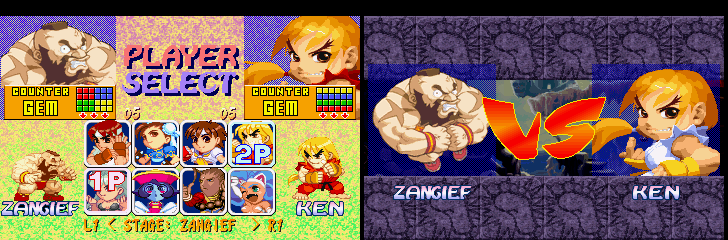
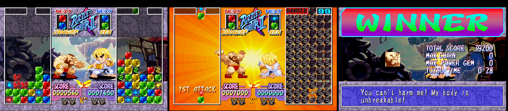
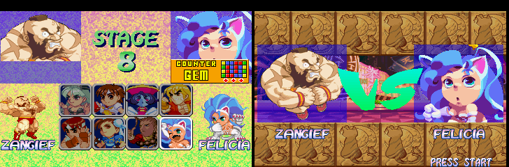
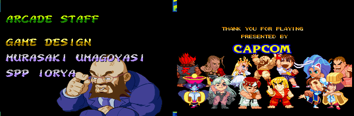

# Super Puzzle Fighter II Turbo X" — PlayStation

**X"** ("X double prime") is the **X' rebalance** ported to the PlayStation version of Super Puzzle Fighter II Turbo
(NTSC-U, **SLUS-00418**), plus PSX-only additions. The headline addition is **Zangief**, taken from Pocket Fighter, as a full hidden character in Versus and Arcade.

X' is David Sirlin's rebalance from Puzzle Fighter HD Remix. It was brought back to
the original arcade game by [KScl/puzzle-fighter-x-prime](https://github.com/KScl/puzzle-fighter-x-prime).
This project reimplements the same logic in the PSX executable. The PSX port is
compiled C rather than 68k assembly, so every change is rewritten from scratch.
The extra prime marks what the PSX version adds on top of X':
- Zangief;
- Dan's new pattern;
- the Versus stage selector;
- challenges where both players choose again.

## Support
Hey dude! Help me out for a couple of :beers: or a :coffee:!<br/>
[](https://bmc.link/zanac)

## What it changes

From X' (the arcade rebalance):
- New drop patterns for Morrigan, Ryu, Hsien-Ko, Felicia and Sakura
- Garbage: Chun-Li sends 120 %, Devilot 85 %, Akuma 100 % but receives 120 %
- Diamond always sends 80 % ("diamond trick" removed)
- Mei-Ling and Anita count as Hsien-Ko and Donovan (no +25 %); the Versus Difficulty 1-5 handicap stays as in vanilla
- Devilot, Akuma and Dan selectable without codes

X" additions (PSX only):
- **Zangief from Pocket Fighter**, a hidden character in Versus and Arcade:
  - his own sprites, animations, voices, portraits, name call, quotes, stage and music;
  - his own Arcade run and ending;
  - all of it built from your own Pocket Fighter disc (see [Zangief](#zangief)).
- **Dan:** new "Gadoken" drop pattern (red spine: columns 1/3/5 red, mixed pairs between) instead of all red; sends 110 % and receives 110 %
- **Versus stage selector:** RANDOM (default), NORMAL or a fixed stage (Zangief's castle included), chosen by P1 on the select screen
- **Challenges:** when a second player joins an Arcade game, both players choose their character again
- `X"` marker in game, `X" BALANCE PATCH BY ZANAC` on the title screen

## Zangief

Zangief is the twelfth playable character, hidden like Mei-Ling and Anita.
- **Picking him.** On the select screen's bottom row, keep pressing Down after Anita.
- **Where he plays.** Versus and Arcade.
- **Where he comes from.** Everything of his comes from Pocket Fighter, converted at build time from your own disc: the repository and the release carry no game data.

**Select and VS screens.** He has a portrait, a name label, a name call and a Counter Gem preview of his pattern. In Versus, the stage line offers his stage.



**In the match.** He gets:
- Pocket Fighter's castle as his stage, with its own music;
- his name on the HUD;
- Pocket Fighter's sprites, scaled to SPF2T's size, with his attacks, Spinning Piledriver and Siberian Bear;
- Pocket Fighter's voices;
- his own win quotes from Pocket Fighter on the WINNER screen.

He sends and receives 90 %, and drops the "Siberian Bear" pattern (3×2 blocks).



**Arcade.**
- **His own run.** Felicia, his rival in Pocket Fighter, is his 8th opponent, before Dan and the bosses.
- **As a challenger.** In the other characters' runs, he sometimes takes Dan's place as a CPU challenger, one time in two.



**Ending.** As for every character, the staff roll shows him beside the credits. His figure is the picture of his Pocket Fighter Arcade opening: in a suit on a plane, adjusting his glasses. On **HARD**, he also joins the cast in the final "THANK YOU FOR PLAYING" scene. He comes last, in the middle of the back row under the logo, and flexes.



## Screenshots

**Title screen.** `X" BALANCE PATCH BY ZANAC` is shown under the copyright.


**Secret characters without codes.**
- **The ring.** On the bottom row, Down cycles the cell through Devilot → Akuma → Dan → Mei-Ling → Anita → Zangief and back. Up walks the same ring backwards.
- **Labels.** Mei-Ling and Anita get their own name labels, which the original select screen never had.


**New drop patterns.** Counter Gem patterns, vanilla (top) vs X" (bottom), drawn from the game's own pattern tables.


**In game.** `X"` sits between the win counters, where the arcade patch puts its `X'`.


**Versus stage selector.** P1 picks the stage under the character grid with **R1** (next) and **L1** (previous). From left to right: RANDOM, then AKUMA, and the match that follows on Akuma's stage.


RANDOM changes the stage at every match:


**Challenges in Arcade.** When P2 joins, the defender can change character too. Both cursors start on the last character picked.


## Status

Done:

- **Drop patterns.** New patterns for the five characters, Dan and Zangief, including the Counter Gem previews on the select screen.
- **Damage formula.** It reproduces the arcade X' patch exactly. It was fuzz-tested in an emulator against a Python model of the arcade code.
- **Diamond.** It always applies its penalty, so the diamond trick is gone.
- **Character select.** Pressing Down on the bottom row cycles through Devilot, Akuma, Dan, Mei-Ling, Anita and Zangief. The select screen now has name labels for Mei-Ling, Anita and Zangief.
- **Zangief.** He is complete in Versus and Arcade, ending included: see [Zangief](#zangief).
- **Markers.** `X"` appears between the win counters during matches, and `X" BALANCE PATCH BY ZANAC` appears on the title screen.
- **Codes.** The old secret-character codes are disabled; cycling replaces them.
- **Versus stage selector.** It is described below.
- **Challenges.** In vanilla, a challenger in Arcade chooses alone and the defender keeps the character. Now both choose again, starting from their last character. After a Versus match, CONTINUE already lets both players change, as in vanilla.
- **Output formats.** The build always writes BIN + CUE and PBP, whatever the input.

See [docs/RESEARCH.md](docs/RESEARCH.md) for the map of the PSX executable, and [docs/NEW-CHARACTER-RESEARCH.md](docs/NEW-CHARACTER-RESEARCH.md) for how Zangief was added.

## Versus stage selector

In Versus, the character select shows a stage line under the grid. **P1** presses **R1** (next) or **L1** (previous), before confirming, to move through:

`NORMAL → RANDOM → MORRIGAN → CHUN-LI → RYU → KEN → HSIEN-KO → DONOVAN → FELICIA → SAKURA → DEVILOT → AKUMA → ZANGIEF`

- **RANDOM** is the default. It draws a new stage at every match and never repeats the stage of the previous match. It picks ZANGIEF more often (3 in 13 instead of 1 in 11) when Zangief plays.
- **NORMAL** is the vanilla behaviour: the stage of P1's character (Pocket Fighter's castle for Zangief).
- A **fixed stage** is used for every match.
- Each stage brings its own music, as in vanilla.
- The choice is kept from match to match (CONTINUE) and goes back to RANDOM when the title screen comes back.
- In a 3-round match, the stage stays the same for every round.
- Arcade, Street Puzzle and the demo are not changed.


Details: [docs/PROPOSAL-random-stage.md](docs/PROPOSAL-random-stage.md), and section 7b of [docs/RESEARCH.md](docs/RESEARCH.md).

## Download and building

Get the zip from [Releases](https://github.com/zanac/psx-puzzle-fighter-x-prime/releases). It contains tools only, no game data.

You need:
- Your own **Super Puzzle Fighter II Turbo, NTSC-U, SLUS-00418** image.
- Your own **Pocket Fighter, NTSC-U, SLUS-00653** image (Zangief's graphics, voices, stage, music and ending picture are built from it).
- Python 3. Nothing else is needed.

Each image can be a BIN, a CUE (one or more BIN files, e.g. a Redump set) or a PBP.

```sh
./patch.sh spf2t.pbp "Pocket Fighter.cue" xdprime     # any mix of .bin / .cue / .pbp
```

Whatever the input, you always get all three outputs:

| File | Use |
|---|---|
| `xdprime.bin` + `xdprime.cue` | one BIN with all 3 tracks (data + 2 CD audio) |
| `xdprime.pbp` | single-disc PBP |

**PSP.**
- **From a PBP input,** the patched PBP keeps the original header and PSP loader, so it behaves like the original on a PSP.
- **From a BIN/CUE input,** the PBP is built from scratch without a `DATA.PSP`. It works in emulators, but a real PSP needs a PBP made with a PSP tool from the patched BIN/CUE.

**Checks.**
- A BIN input without a `.cue` beside it gets its track layout from the known layout of this disc.
- Both discs are checked by the SHA-1 of their executables, so other versions are rejected.
- The patched executable is checked against the file table built from your Pocket Fighter disc.

Tested on PCSX ReARMed with all three outputs; reports from other emulators or real hardware are welcome.

### Building from source

```sh
./build.sh spf2t.pbp "Pocket Fighter.cue" xdprime path/to/armips
```

`patch.sh` is `build.sh` without the last argument.
- **Without armips,** the executable comes from `xprime-patch.json`.
- **With [armips](https://github.com/Kingcom/armips),** it is assembled from `src/`.
- **Writing the patch.** `XP_MKPATCH=xprime-patch.json` also writes the patch from the assembled executable.

Everything else (Zangief's files, the Counter Gem previews, the name labels) is
always built by the Python tools from your discs.

## How to play the secret characters

On the character select screen, move to the bottom row and keep pressing **Down**.
- **Down** cycles the character on that cell through Devilot, Akuma, Dan, Mei-Ling, Anita and Zangief, then back to the cell's own character.
- **Up**, while a secret character is shown, goes back one step in the same ring (Zangief → Anita → Mei-Ling → Dan → Akuma → Devilot → the cell's character). On the cell's own character, Up moves to the top row as usual.
- **Left or Right** return to the normal grid.
- **Colours.** As in vanilla, the button used to confirm picks them: Circle or Triangle give the standard colours, Cross or Square the alternate ones.

Mei-Ling and Anita keep Hsien-Ko's and Donovan's portrait on the select
screen, with their own name label; they appear as themselves in the match.
Zangief has his own portrait, label and name call.

## How to choose the Versus stage

On the Versus character select, before confirming the character, P1 presses
**R1** to go to the next setting or **L1** to go back. The line
`L1 < STAGE: name > R1` under the grid shows the setting (NORMAL, RANDOM or
a stage name). RANDOM is already selected when you enter Versus.
P2's L1/R1 do nothing.

## Challenges and rematches

- **Versus, after a match:** choose CONTINUE on the RESULT screen. Both
  players are back on the character select, with the cursor on their last
  character, and both can change it (vanilla behaviour).
- **Arcade, when a second player joins:** the challenger and the player who
  was already in the game both choose their character. The cursors start on
  the last character picked. Whoever wins goes on with the Arcade, using the
  character chosen for the challenge.

## Tools

| Path | Purpose |
|---|---|
| `patch.sh`, `build.sh` | build the game from both discs (`build.sh` with armips assembles `src/`) |
| `tools/applypatch.py` | apply `xprime-patch.json` to the original executable (no assembler needed) |
| `tools/mkpatch.py` | create `xprime-patch.json` from the original and an assembled executable |
| `tools/checkexe.py`, `tools/checkpf.py` | check the SPF2T and Pocket Fighter discs |
| `tools/discout.py` | disc input (BIN, CUE, PBP) and output (BIN + CUE + PBP); also converts between them |
| `tools/extract.py` | extract one file from a disc image |
| `tools/discexpand.py`, `tools/makedisc.py` | add new files to the disc (moving the CD audio) and write the output |
| `tools/discpatch.py` | replace files in a BIN or PBP (EDC/ECC, PBP rebuild) |
| `tools/pbp2bin.py` | PSX PBP (PSISOIMG) → BIN/CUE |
| `tools/psxiso.py` | list / extract the ISO9660 file system of a raw BIN |
| `tools/zangief.py` | Zangief's character file, voices, name call and ending picture from Pocket Fighter |
| `tools/pf_sprites.py`, `tools/spf_sprites.py` | Pocket Fighter and SPF2T sprite formats |
| `tools/pf_stage.py` | Zangief's stage and music from Pocket Fighter (castle picture, XA channel) |
| `tools/pf_texts.py` | Pocket Fighter's win quotes, rival dialogue and Arcade story, decoded from your disc (Markdown) |
| `tools/vab.py` | Sony VAB / VAG sound banks |
| `tools/previews.py` | redraw the Counter Gem previews from the EXE table |
| `tools/lzh.py` | codec for the sprite-graphics LZ (decoder `0x8010D5C0`) |
| `tools/labels.py` | builds the MEI-LING / ANITA / ZANGIEF select-screen labels in FIRST.EMI |
| `tools/findpat.py` | scan a file for drop-pattern-shaped tables |
| `src/xprime.asm` | the executable patch (with `src/stage.asm`, `src/zangief.asm`) |
| `tools/regress.py` | end-to-end regression in the emulator (screens, damage, secrets, Zangief's Arcade and ending) |
| `tools/model.py` | Python model of the arcade X' damage formula (for tests) |
| `tools/nav.py` | menu navigation helpers for the emulator tests |
| `tools/lr.py` | headless libretro frontend (input scripting, RAM access, savestates, screenshots, watchpoints) |
| `emu/build.sh` | builds an instrumented pcsx_rearmed libretro core (`emu/pcsx_rearmed-xdbg.patch`) |

```sh
emu/build.sh
python3 tools/pbp2bin.py game.pbp work/spf2t
python3 tools/psxiso.py work/spf2t.bin extract work/fs
```

No game data is included in this repository.

## Credits

- Balance design: David Sirlin (Puzzle Fighter HD Remix)
- Arcade X' patch: KScl
- PSX port, X" additions and Zangief: Vanni Brutto
- Zangief's graphics, voices, stage and music: Capcom's Pocket Fighter, read from your own disc
