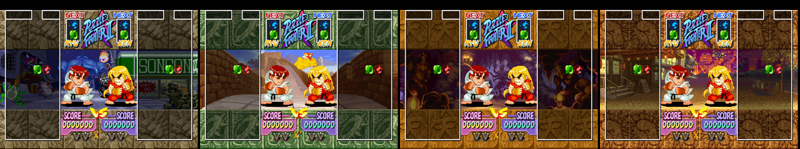
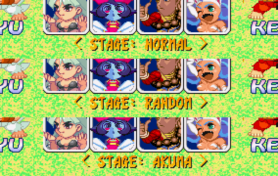
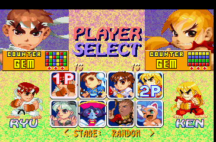
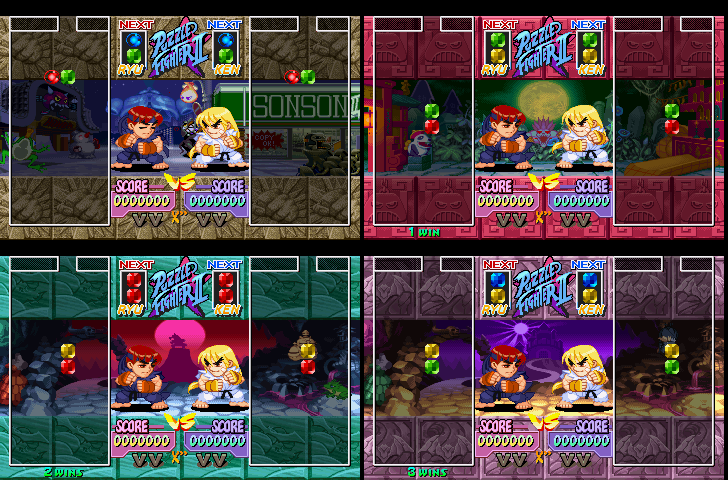

# Proposal: stage selector for Versus (random or fixed)

Developed on the branch `experimental/random-stage`, now merged into `main`. Status: **implemented (proposal A)**, see `src/stage.asm`.

Decisions taken: proposal A, changed by P1 only. Later changed to: R1/L1 instead of SELECT, RANDOM as the default. The setting keeps the last choice between matches, until the title screen comes back. RANDOM never gives the same stage twice in a row.

## What the user asked

In Versus, a way to play on a random stage, selectable by the players.

## How vanilla picks the stage (research)

| What | Where |
|---|---|
| Stage index (halfword) | `0x8019FC98` (`0x8019FC8C + 0x0C`) |
| Written by | `0x8012CCF4`: `stage = player[s2].char` (`+0x68`). In our Versus test (Ryu vs Ken) it is **P1's character** |
| Stage dispatch tables | `0x80166728` (load the stage file), then `0x80166754` and `0x80166780` (other per-stage handlers); 11 entries each, index = character |
| Stage files | `DATA/STAGE00..09.EMI`, file ids `0x4A + n` in the LBA table `0x80165CC0` |
| Loader | `0x80107944`: if `stage != cached (0x801BF114)` call `table[stage]` |

- There are **10 distinct stages** (one per character from Morrigan to Akuma).
  Index 10 (Dan) reuses Ken's stage (same function, file `STAGE03`).
  Mei-Ling and Anita use Hsien-Ko's and Donovan's stages.
- **The music follows the stage, not the characters.** Forcing the stage
  index in the emulator changes the match music (audio hashes differ) and
  keeps the same characters. So a random stage brings its own music.
- Forcing any index 0..10 at `0x8012CCE0` works: background, frame colour
  and music all change, the match plays normally.

## Proposal A (recommended): stage line on the select screen

A line under the character grid, **Versus only**:

(Real mockup: the text is written to the game's own text layer in the
emulator, same font and palette as the in-match `X"` marker.)

- **R1** next / **L1** previous (P1 only, until P1 confirms) change the setting
  (first version used SELECT; changed to L1/R1 on request):
  `NORMAL → RANDOM → MORRIGAN → CHUN-LI → RYU → KEN → HSIEN-KO → DONOVAN →
  FELICIA → SAKURA → DEVILOT → AKUMA → NORMAL`.
  A short menu sound on each press.
- `NORMAL` = vanilla (stage of P1's character).
- `RANDOM` = one of the 10 stages, drawn again **at every match**, never
  the stage of the previous match.
  Seed: the PSX hardware root counter mixed with the frame counter, so it
  depends on when the players press the buttons (good enough, no fixed
  sequence).
- Fixed stage = that stage every match.
- The setting is kept from match to match and goes back to `RANDOM` (the default) when
  the title screen comes back (it is not saved to the memory card).
- Arcade, Street Puzzle and demo are **not** touched.

Implementation sketch (small):

1. Hook `0x8012CCE0` (where the stage index is computed): if mode is Versus
   (`0x8019C40F == 3`) and the setting is not `NORMAL`, replace the index
   (fixed value, or random 0..9).
2. Select-screen per-frame hook: read SELECT edge for both pads, cycle the
   setting, print the line with the vanilla print routine `0x80107CB8`.
3. Erase the line on scene change (we already have a scene-init hook for
   the `X"` marker).
4. Code space: about 150-200 bytes, in the free areas we already use.

## Proposal B (minimal): always random in Versus

No UI: every Versus match uses a random stage. One hook, very small. Less
flexible: no way back to vanilla, no way to pick a stage.

## Proposal C: entry in the Options menu

`VS STAGE: NORMAL / RANDOM / <stage>` in the Options screen. Cleaner place,
but the menu code is not mapped yet: much more work and risk for the same
result as A.

## Result

Tested in the emulator:
- Every setting gives the expected stage index.
- RANDOM over 8 matches in a row gave 7, 1, 6, 5, 7, 1, 4, 0, with no stage repeated back to back.
- The setting survives CONTINUE and is back to the default after END and the title.
- The line is erased on the VS screen and in matches, where the X" marker is intact.
- The Arcade select has no line, and the Arcade stages are vanilla.
- The full regression passes: damage fuzz 150/150, select, Arcade with Devilot, Street Puzzle and demo.
